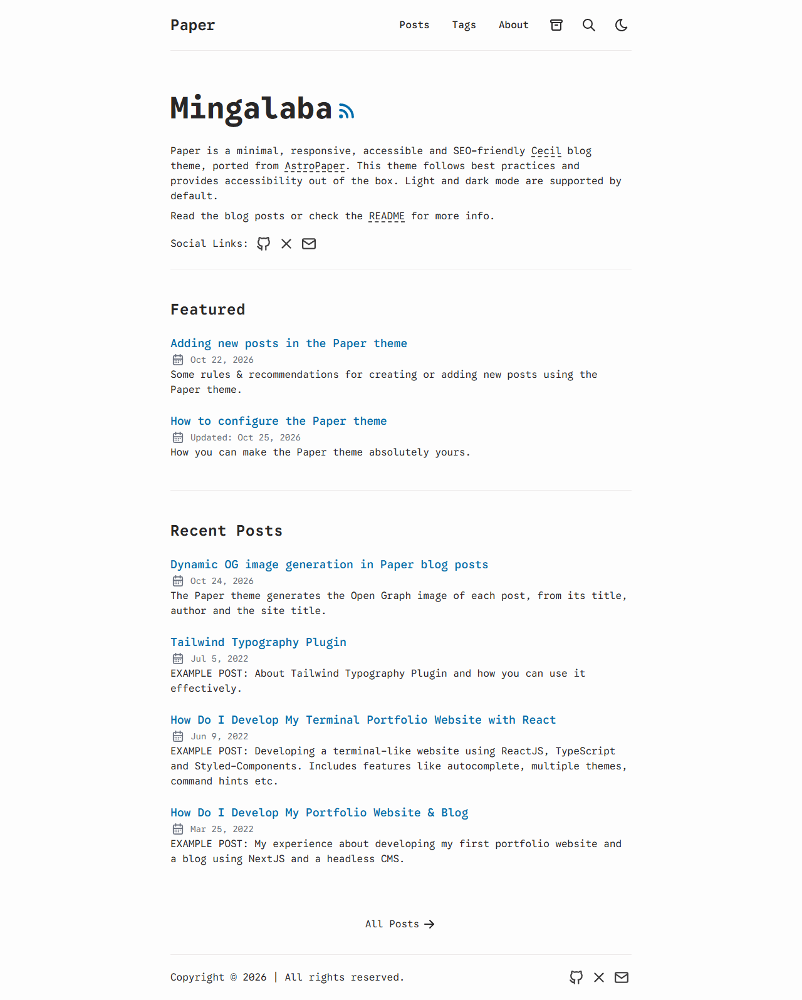

# Paper theme

The _Paper_ theme for [Cecil](https://cecil.app) is a minimal, responsive, accessible and SEO-friendly blog theme, ported from [AstroPaper](https://github.com/satnaing/astro-paper) by [Sat Naing](https://satna.ing).



**[Demo](https://demo.cecil.app/theme-paper/)**

## Features

- Minimal, responsive and accessible design (keyboard navigation, skip link, ARIA labels)
- Light and dark color schemes, with the [dark mode toggle](https://github.com/Cecilapp/theme-darkmodetoggle) component theme
- SEO-friendly: Cecil built-in metatags (Open Graph, Twitter cards, JSON-LD `BlogPosting`), sitemap and Atom feeds
- **Dynamic Open Graph images**, generated for each post (title, author and site title)
- Featured and recent posts on the homepage
- Paginated posts list, tags, archives (by year and month)
- Posts: reading progress bar, "Go back" and "Back to top" buttons, previous and next posts, share links, "Edit page" link, collapsible table of contents, copy button on code blocks, images lightbox
- Callouts (`:::note`, `:::tip`, `:::important`, `:::warning`, `:::caution`…) and Cecil notes (steps, accordion, tabs, cards)
- Optional search with the [FlexSearch](https://github.com/Cecilapp/theme-flexsearch) component theme
- Translatable (English and French included)

## Installation

Allow the theme installer plugin in the `composer.json` file of your Cecil project (required since Composer 2.2):

```json
{
  "config": {
    "allow-plugins": {
      "cecil/theme-installer": true
    }
  }
}
```

Then require the theme:

```bash
composer require cecil/theme-paper
```

> Or [download the latest archive](https://github.com/Cecilapp/theme-paper/releases/latest/) and uncompress its content in `themes/paper`, together with the [darkmodetoggle](https://github.com/Cecilapp/theme-darkmodetoggle/releases/latest/) theme in `themes/darkmodetoggle`.

## Usage

Add `paper` and `darkmodetoggle` in the `theme` section of your configuration file (`cecil.yml`):

```yaml
theme:
  - paper
  - darkmodetoggle
```

Write your posts in `pages/posts/`, and disable the pagination of the homepage in `pages/index.md` (its content is the introduction of the homepage):

```yaml
---
title: Hello
pagination: false
---
Welcome to my blog.
```

### Front matter of posts

| Variable      | Description                                                       |
| ------------- | ----------------------------------------------------------------- |
| `title`       | Title of the post                                                 |
| `description` | Description, used in the posts lists and the meta tags            |
| `date`        | Publication date                                                  |
| `updated`     | Modification date (displayed when more recent than `date`)        |
| `author`      | Author (site `author` by default)                                 |
| `tags`        | Tags                                                              |
| `featured`    | Displays the post in the _Featured_ section of the homepage       |
| `draft`       | Unpublishes the post                                              |
| `image`       | Open Graph image (otherwise an image is generated)                |
| `hide_edit`   | Hides the _Edit page_ link                                        |

Add `[toc]` in the body of a post to display a collapsible table of contents.

### Search

Install the [FlexSearch](https://github.com/Cecilapp/theme-flexsearch) component theme to display a search button in the header:

```bash
composer require cecil/theme-flexsearch
```

```yaml
theme:
  - flexsearch
  - paper
  - darkmodetoggle
```

### Configuration

Options and their default values:

```yaml
paper:
  posts:
    section: posts # section containing the blog posts
    home: 4        # number of recent posts displayed on the homepage
  dir: ltr         # text direction: ltr or rtl
  archives: true   # displays the archives link in the header
  back_button: true # displays the "Go back" button on posts
  edit:
    url: ''        # e.g.: https://github.com/<user>/<repo>/edit/main/pages/ (empty to disable)
  og:
    dynamic: true  # generates Open Graph images of posts (and of the site) without image
  socials: []      # social links: [{name: github, url: 'https://github.com/username'}]
  share:           # share links of posts (`false` to disable)
    - {name: whatsapp, url: 'https://wa.me/?text='}
    - {name: facebook, url: 'https://www.facebook.com/sharer.php?u='}
    - {name: x, url: 'https://x.com/intent/post?url='}
    - {name: telegram, url: 'https://t.me/share/url?url='}
    - {name: pinterest, url: 'https://pinterest.com/pin/create/button/?url='}
    - {name: mail, url: 'mailto:?subject=See%20this%20post&body='}
```

Icons available for social and share links: `github`, `x`, `linkedin`, `facebook`, `telegram`, `whatsapp`, `pinterest` and `mail` (add your own in `assets/paper/icons/<name>.svg`).

The theme also sets these Cecil options:

```yaml
taxonomies:
  tags: tag
menus:
  main: # the header menu (the homepage entry is not displayed)
    - {id: index, enabled: false}
    - {id: posts, name: Posts, url: posts, weight: 10}
    - {id: tags, name: Tags, url: tags, weight: 20}
pages:
  pagination:
    max: 4 # posts per page
  default:
    archives: # the archives page (`published: false` to disable it)
      path: archives
      layout: archives
metatags:
  articles: posts
```

> [!NOTE]
> A `menus.main` list defined by the site replaces the theme one: declare the _Posts_ and _Tags_ entries again.

If the posts section is not `posts`, set `paper.posts.section`, `metatags.articles`, and map the section to the posts layouts:

```yaml
layouts:
  sections:
    blog: posts
```

### Open Graph images

When a post has no `image`, an Open Graph image (1200 × 628) is generated with its title, author and the site title, and published next to the post (`og.png`). Other pages use an image of the site (title and description) when the `image` option of the site is not set.

It requires the PHP GD extension with FreeType support. The background (`assets/paper/og-background.png`) and the fonts (`assets/paper/fonts/`) can be overridden by the site.

### Colors

Override the CSS custom properties in a stylesheet of the site (extend the `head_css` block of `page.html.twig`):

```css
:root, [data-theme='light'] {
  --background: #fdfdfd;
  --foreground: #282728;
  --accent: #006cac;
  --accent-foreground: #ffffff;
  --muted: #e6e6e6;
  --muted-foreground: #6b7280;
  --border: #ece9e9;
}
[data-theme='dark'] {
  --background: #212737;
  --foreground: #eaedf3;
  --accent: #ff6b01;
  --accent-foreground: #ffffff;
  --muted: #343f60;
  --muted-foreground: #afb9ca;
  --border: #ab4b08;
}
```

The font family can be changed with `--paper-font`.

### Internationalization

The theme is translated in English and French (`translations/messages.fr.yml`). Add your own translations in the `translations/` directory of the site.

## Development

Styles are built with [Tailwind CSS](https://tailwindcss.com) (`assets/paper/tailwind.css` → `assets/paper/paper.css`):

```bash
composer install
composer css:build # or css:watch
```

Run the demo site:

```bash
composer install --working-dir=demo # dark mode toggle and FlexSearch themes
php demo/link.php
php cecil.phar serve demo
```

## Credits

- [AstroPaper](https://github.com/satnaing/astro-paper) by Sat Naing (MIT)
- [Google Sans Code](https://github.com/googlefonts/googlesans-code) font (SIL Open Font License)
- [Tabler Icons](https://tabler.io/icons) (MIT)

## License

_Paper_ is a free software distributed under the terms of the MIT license.